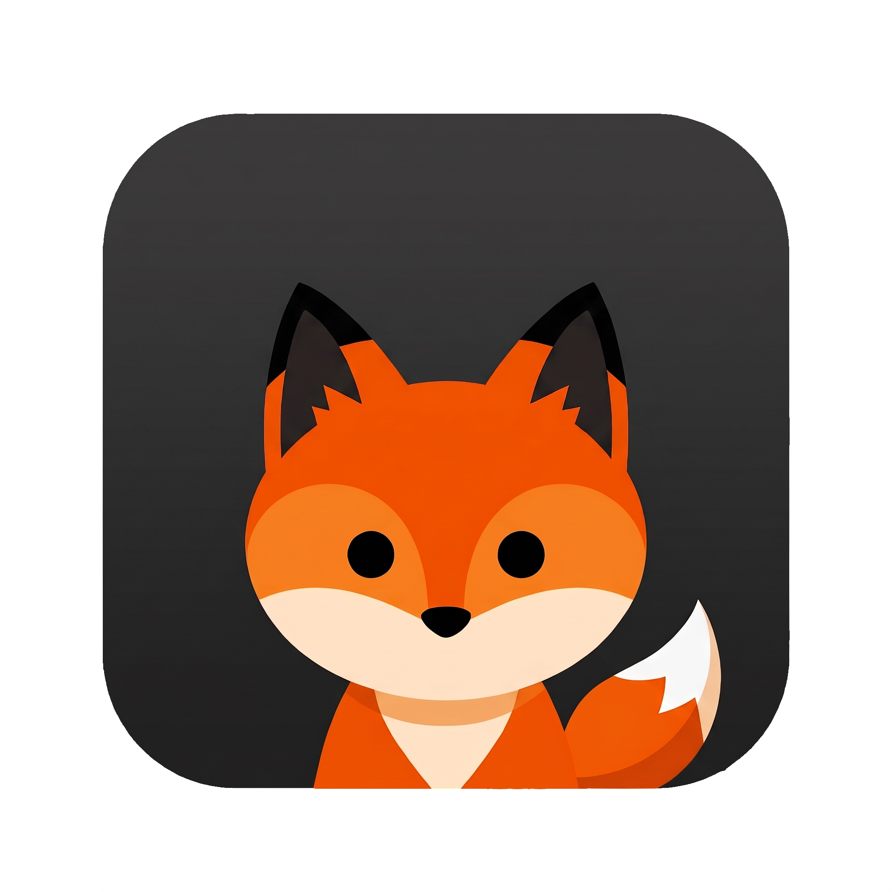

<div align="center">



# KDIStudios

**A sleek, lightweight Dynamic Island for Windows - built in Rust.**


*Fast AI assistant, local Wi-Fi file & clipboard transfer, smart per-app music volume, and productivity tools - all living seamlessly at the top of your screen.*

---

</div>

## Features

| Module | What it does |
| :--- | :--- |
| **Built-in Gemini AI** | Powered by **Gemini 4 Hydrogen** (with quick in-UI model switching), automatic **multi-API key failover**, smooth typewriter animation, full mouse/keyboard text selection, and one-click copy feedback. |
| **Local Wi-Fi Transfer** | Send files, links, and clipboard text between your PC and phone over local Wi-Fi via a **single QR code scan**. 100% local, zero external servers, styled in KDIStudios' dark charcoal & orange theme. |
| **Smart Music & Per-App Volume** | Live album art, synced lyrics, and **dynamic per-app volume control** that adjusts only your active music player without touching Discord or Windows master volume. |
| **Drag & Drop Shelf** | Temporarily hold files right inside the island and send them straight to your phone or drag them into any app. |
| **Focus, Tasks & System** | Built-in Pomodoro focus timer, quick task manager, and real-time CPU, RAM, network, and top-process monitoring. |

---

## Installation

1. Go to the **Actions** (or **Releases**) tab of this repository and download **`KDIStudios-Setup.exe`**.
2. Run the installer - it automatically configures:
   * Windows startup (*Start with Windows*)
   * Windows Firewall rules for instant local Wi-Fi phone transfers
3. Launch **KDIStudios** and hover over the top-center of your screen to expand the island.

---

## Building from Source

Requires the [Rust toolchain](https://rustup.rs/) (Windows x64):

```bash
git clone [https://github.com/k7sn/KDI-Studio.git](https://github.com/k7sn/KDI-Studio.git)
cd KDI-Studio
cargo build -p poni --release
```

The compiled executable will be available at `target/release/poni.exe`.

---

<div align="center">
<sub>Fork custom di Oyenza Studios</sub>
</div>
